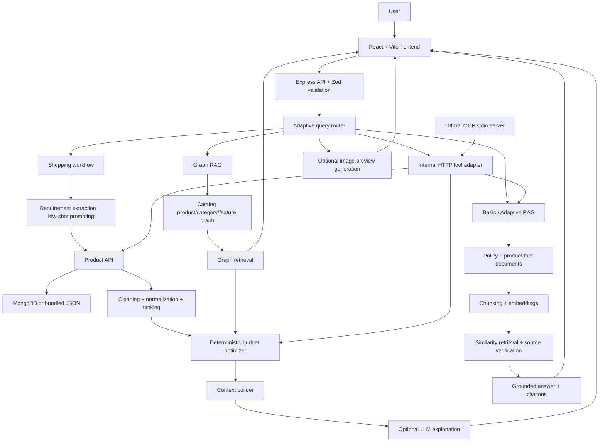

# AI Budget Shopping Assistant

An AI-powered shopping assistant that recommends **verified product combinations within a user-defined budget**. The project combines the practical AI-engineering topics studied in **EdVergenceX**—API integration, data handling, prompt engineering, context engineering, multimodal AI, RAG, Adaptive RAG, Graph RAG, MCP tools, model evaluation, image generation, session memory, and deterministic business logic—into one full-stack application.

> **Core guarantee:** product IDs, product facts, availability, prices, combinations, totals, and remaining budgets are controlled by backend code. The LLM explains verified results; it does not invent catalog facts or calculate authoritative totals.

---

## Table of contents

- [Project objective](#project-objective)
- [EdVergenceX topic coverage](#edvergencex-topic-coverage)
- [How the topics combine](#how-the-topics-combine)
- [System architecture](#system-architecture)
- [Feature overview](#feature-overview)
- [Technology stack](#technology-stack)
- [Project structure](#project-structure)
- [Installation and setup](#installation-and-setup)
- [Running the application](#running-the-application)
- [Using the application](#using-the-application)
- [API reference](#api-reference)
- [MCP server](#mcp-server)
- [Environment variables](#environment-variables)
- [Testing and validation](#testing-and-validation)
- [Security and reliability](#security-and-reliability)
- [Fallback behavior](#fallback-behavior)
- [Known limitations](#known-limitations)
- [Learning demonstration](#learning-demonstration)
- [Documentation](#documentation)

---

## Project objective

The assistant helps a user answer questions such as:

> I have ₹5,000. I need a backpack, headphones, and a smartwatch for college.

The application then:

1. Extracts the budget, product categories, and preferences.
2. Loads products from the backend catalog.
3. Cleans, normalizes, deduplicates, and filters the catalog.
4. Searches for valid product combinations.
5. Verifies that the total is within the budget.
6. Uses an optional LLM to explain the verified recommendation.
7. Displays products, prices, alternatives, totals, and remaining budget in the React interface.

The assistant also supports knowledge questions, relationship searches, structured tools, image analysis, visual previews, model comparison, and optional external product JSON data.

---

## EdVergenceX topic coverage

The table below shows how the topics covered in EdVergenceX were integrated into this project.

| EdVergenceX topic | How it is used in this project | Main implementation | Status |
|---|---|---|---|
| Programming and control flow | Product processing, routing, validation, ranking, and optimization are implemented with JavaScript functions, objects, arrays, loops, conditions, and asynchronous operations. | `backend/src/services/` | Implemented |
| Git and GitHub | The application is maintained as a structured GitHub repository with commit history, source folders, tests, and documentation. | Repository root | Implemented |
| API integration | Express exposes the shopping assistant API, while the product service loads MongoDB data or the bundled JSON catalog. | `productApi.js`, `routes/api.js` | Implemented |
| Public API and JSON handling | An optional external JSON product provider is fetched, validated, normalized, deduplicated, and filtered through the existing pipeline. | `externalProductApi.js`, `GET /api/external-products` | Implemented |
| Data cleaning | Invalid products are removed; prices, categories, ratings, availability, and arrays are normalized; duplicates and out-of-stock products are filtered. | `dataProcessing.js`, `normalize.js` | Implemented |
| Data filtering and ranking | Products are ranked using category relevance, preferences, ratings, value, and optional visual hints. | `dataProcessing.js` | Implemented |
| Budget optimization | The backend generates combinations and calculates totals and remaining budgets. It guarantees `totalPrice <= budget`. | `budgetOptimizer.js` | Implemented |
| Prompt engineering | Separate prompts are used for requirement extraction, recommendation explanations, chat replies, vision analysis, and grounded RAG answers. | `prompts.js`, `llm.js` | Implemented |
| Few-shot prompting | Shopping examples guide the model to normalize phrases such as “bag” to `backpack` and “watch” to `smartwatch`. | `prompts.js`, `requirementExtractor.js` | Implemented |
| Structured output | Zod schemas validate API and tool inputs; LLM JSON is parsed and checked before use. | `validate.js`, `llm.js` | Implemented |
| Prompt-injection defense | Retrieved documents are treated as untrusted reference data, not executable instructions. | `ragAnswer.js` | Implemented |
| Context engineering | The model receives a structured context containing the user, requirements, verified products, combinations, history, visual context, and pipeline statistics. | `contextBuilder.js` | Implemented |
| Multimodal AI | Users can upload product images for conservative product-type, color, style, and visual-description analysis. | `vision.js`, `POST /api/analyze-image` | Implemented |
| Session memory | Requirements, visual context, and a bounded conversation history are retained per session. | `sessionStore.js`, `ChatSession.js` | Implemented |
| Basic RAG | Policy and product-fact documents are loaded, chunked, embedded, retrieved, and cited in grounded answers. | `backend/src/services/rag/` | Implemented |
| Adaptive RAG | A deterministic router selects the appropriate workflow and performs at most one bounded retrieval rewrite when context is weak. | `queryRouter.js`, `adaptiveRag.js` | Implemented |
| Graph RAG | A graph of products, categories, features, brands, and catalog relationships is searched for related candidates. | `backend/src/services/graph/` | Implemented |
| Tool calling and MCP concepts | Four typed tools provide structured product search, product details, bundle validation, and policy lookup. | `backend/src/mcp/`, `POST /api/tools/:toolName` | Implemented |
| MCP protocol integration | A separate official MCP SDK server exposes the same shopping tools through stdio transport. | `protocolServer.js`, `start.js` | Implemented |
| Image generation | Verified catalog products can be used to create an illustrative shopping-board preview. | `imageGeneration.js` | Implemented |
| Model comparison | Allowlisted models can be evaluated independently without changing production recommendations or budget totals. | `modelEvaluation.js`, `POST /api/evaluate/models` | Implemented |
| Python data handling | A small optional Python script demonstrates JSON loading, cleaning, grouping, and summary statistics. | `tools/python_catalog_analysis.py` | Implemented as an educational example |
| Security and validation | Requests, product IDs, budgets, uploads, tools, and provider failures are validated and handled safely. | Middleware and service layer | Implemented |

For a file-by-file mapping, see [`docs/edvergencex-topic-mapping.md`](docs/edvergencex-topic-mapping.md).

---

## How the topics combine

The project combines the EdVergenceX topics into one routed AI workflow.

### Example: budget shopping request

```text
User message
    ↓
React frontend
    ↓
POST /api/chat
    ↓
Adaptive query router
    ↓
Requirement extraction with heuristics + few-shot LLM support
    ↓
Product API: MongoDB or JSON catalog
    ↓
Data cleaning and normalization
    ↓
Product filtering and ranking
    ↓
Deterministic budget optimizer
    ↓
Context builder
    ↓
Optional LLM explanation
    ↓
Verified recommendation shown in React
```

### Example: policy question

```text
User question
    ↓
Query router identifies a knowledge request
    ↓
Adaptive RAG retrieves relevant chunks
    ↓
Topic-aware source verification
    ↓
Grounded answer using only retrieved material
    ↓
Source names and scores shown in the UI
```

### Example: product relationship question

```text
User question
    ↓
Query router identifies a graph request
    ↓
Catalog graph retrieves connected product candidates
    ↓
Out-of-stock products are excluded
    ↓
Candidates pass through the normal product pipeline
    ↓
Budget optimizer verifies the final combination
```

### Example: tool request

```text
User request
    ↓
Tool route
    ↓
Validated tool schema
    ↓
Existing catalog, optimizer, or RAG service
    ↓
Structured JSON result
    ↓
Tool result panel in the frontend
```

---

## System architecture



---

## Feature overview

### Verified budget recommendations

- Accepts a fixed budget in INR or another supported currency field.
- Supports multiple requested categories.
- Uses backend catalog values rather than browser-supplied prices.
- Returns the best combination and alternatives.
- Shows total price and remaining budget.
- Never returns an over-budget combination.

### Product data pipeline

The product pipeline follows this order:

```text
Validate
  → Clean
  → Normalize
  → Deduplicate
  → Filter availability
  → Filter requirements
  → Rank products
  → Limit context sent to the LLM
```

### Basic and Adaptive RAG

The knowledge base contains:

```text
backend/src/services/rag/documents/
├── delivery-policy.txt
├── product-facts.txt
├── refund-policy.txt
├── return-policy.txt
└── warranty-policy.txt
```

The system supports:

- Local deterministic fallback embeddings.
- Optional remote embeddings.
- Topic-aware source boosting.
- Similarity scores.
- Source citations.
- One bounded query rewrite.
- Safe `insufficient_context` responses.
- Prompt-injection-resistant grounding.

The project does not invent retailer policies. If an approved source does not contain a specific warranty period, refund timeframe, delivery date, or return condition, the assistant reports that the information is unavailable.

### Graph RAG

The catalog graph contains relationships between:

- Products.
- Categories.
- Brands.
- Features.
- Prices.
- Ratings.
- Availability.

Graph retrieval identifies candidates, but the normal backend optimizer remains responsible for final budget validation.

### Tools and MCP

The application has two tool surfaces:

1. **Internal HTTP adapter** used by the React application and `/api/chat`.
2. **Official MCP protocol server** using the MCP SDK and stdio transport.

Available tools:

- `search_products`
- `get_product_details`
- `check_budget_bundle`
- `get_policy`

Both surfaces reuse the same services and validation logic.

### Multimodal image analysis

Users can upload JPEG, PNG, WebP, or GIF product images. The assistant extracts conservative visual information and never claims to know details that cannot be determined from the image.

### Image-generation preview

The assistant can optionally generate an illustrative shopping-board preview using verified catalog product categories and known colors. Generated previews are always labelled:

> AI-generated visual preview — not the actual product.

Generated images never overwrite real catalog product images.

### Model comparison

The evaluation endpoint compares only server-allowlisted models. It is isolated from the production shopping workflow and cannot modify catalog data, product selection, prices, or budget totals.

### Official shopping links and alternative selection

The assistant surfaces verified shopping links only when the backend has accepted a safe HTTPS URL for that product. The app does not generate fake product pages, guessed Amazon search URLs, or hidden cart automation links.

Rules enforced by the project:

- `officialUrl` is validated in the backend and must use the `https://` protocol.
- `http://`, `javascript:`, `data:`, and other unsafe protocols are rejected.
- Missing or unverified links are shown as a safe fallback message instead of a clickable fake link.
- Product cards render a "Shop product" action only when a verified product URL is present.
- The main recommendation can be switched to any selected alternative combination.
- Alternative cards show product thumbnails, totals, remaining budget, ratings, and a direct selection action.
- Clicking a verified external shopping link opens a new tab using `target="_blank"` and `rel="noopener noreferrer"`.
- Product-page links are not the same as cart automation; an official product page remains a safe page navigation and should not be described as a cart-add operation unless the retailer explicitly exposes and verifies that flow.

How to add verified official URLs:

- Add `officialUrl` to the verified product record in the backend catalog or database.
- Keep the value as a single, exact HTTPS product page link.
- Reject any non-HTTPS or manipulated retailer URL at validation time.
- If a retailer has not provided a verified product page, leave the field as `null` and show the fallback message.

Amazon/cart limitations:

- The project does not construct undocumented Amazon cart URLs from a local product ID.
- A product-specific shopping page is safe to show only when it is verified and exact.
- A cart or multi-item checkout automation flow must be separately verified by the store and added behind a backend-only service before being claimed as supported.

The backend remains the authority for product values, totals, and availability. The LLM can explain the recommendation, but it cannot generate or change purchase URLs.

### Optional external product API

The external API demo can fetch public JSON product data and run it through the same validation and normalization pipeline. External data cannot automatically replace the verified local catalog.

---

## Technology stack

### Frontend

- React
- Vite
- React Router
- Axios
- Tailwind CSS

### Backend

- Node.js
- Express
- Zod
- Multer
- Mongoose
- Official Model Context Protocol SDK

### AI capabilities

- OpenAI-compatible chat models
- Optional embedding models
- Optional vision models
- Optional image-generation models
- Local deterministic embedding fallback

### Storage

- Bundled JSON catalog fallback
- Optional MongoDB catalog
- In-memory session store fallback
- Optional MongoDB session persistence

---

## Project structure

```text
AI-Budget-Shopping-Assistant/
├── backend/
│   ├── src/
│   │   ├── config.js
│   │   ├── server.js
│   │   ├── routes/api.js
│   │   ├── middleware/
│   │   ├── models/
│   │   ├── data/products.json
│   │   ├── mcp/
│   │   │   ├── server.js              # Internal HTTP/in-process adapter
│   │   │   ├── protocolServer.js      # Official MCP server
│   │   │   ├── start.js
│   │   │   └── tools/
│   │   └── services/
│   │       ├── dataProcessing.js
│   │       ├── budgetOptimizer.js
│   │       ├── contextBuilder.js
│   │       ├── llm.js
│   │       ├── prompts.js
│   │       ├── requirementExtractor.js
│   │       ├── modelEvaluation.js
│   │       ├── externalProductApi.js
│   │       ├── imageGeneration.js
│   │       ├── graph/
│   │       └── rag/
│   └── test/
├── frontend/
│   └── src/
│       ├── pages/
│       ├── components/
│       ├── api.js
│       └── App.jsx
├── docs/
│   ├── architecture-decisions.md
│   ├── edvergencex-topic-mapping.md
│   └── sample-conversations.md
├── tools/
│   ├── README.md
│   └── python_catalog_analysis.py
├── package.json
└── README.md
```

---

## Installation and setup

### Requirements

- Node.js 18 or newer.
- npm.
- Python 3.8 or newer for the optional educational script.
- MongoDB is optional.
- An OpenAI-compatible API key is optional.

### Clone the repository

```bash
git clone https://github.com/asfahana01/AI-Budget-Shopping-Assistant.git
cd AI-Budget-Shopping-Assistant
```

### Install dependencies

```bash
npm install --prefix backend
npm install --prefix frontend
```

Or:

```bash
npm run install:all
```

### Optional environment configuration

Create:

```text
backend/.env
```

A minimal configuration is not required because the project has safe fallbacks. For live AI features, see [Environment variables](#environment-variables).

> **Windows PowerShell:** use `$env:PORT = "3000"` instead of `PORT=3000`.

---

## Running the application

The web application requires two processes: the backend API and the frontend development server.

### Terminal 1: backend

#### Bash, macOS, or Linux

```bash
npm run dev --prefix backend
```

#### Windows PowerShell

```powershell
$env:PORT = "3000"
npm run dev --prefix backend
```

Expected output:

```text
Budget assistant API on http://localhost:3000
```

### Verify the backend

Open:

```text
http://localhost:3000/api/health
```

Expected response:

```json
{
  "ok": true,
  "service": "ai-budget-shopping-assistant"
}
```

### Terminal 2: frontend

```bash
npm run dev --prefix frontend
```

Open:

```text
http://localhost:5173
```

The frontend uses the Vite proxy to forward `/api` requests to `http://localhost:3000`.

### Start both services together

From the project root:

```bash
npm run dev
```

Running the services in two terminals is recommended because it makes backend errors easier to see.

---

## Using the application

Try these messages in the chat interface:

### Shopping recommendation

```text
I have ₹5000. I need a backpack, headphones and a smartwatch for college.
```

### Policy question

```text
Can opened headphones be returned?
```

### Graph question

```text
Which in-stock backpacks are water resistant?
```

### Tool request

```text
Search in-stock wireless headphones under ₹2000.
```

### Image preview request

```text
Create a visual preview of a backpack and headphones.
```

### Clarification request

```text
Hello
```

The assistant should request more information instead of inventing a recommendation.

---

## API reference

All API routes are prefixed with `/api`.

| Method | Endpoint | Purpose |
|---|---|---|
| `GET` | `/api/health` | Check backend availability. |
| `GET` | `/api/products` | Return the cleaned catalog. Supports `?category=headphones`. |
| `POST` | `/api/chat` | Route a conversational request to shopping, RAG, graph, tool, preview, or clarification workflows. |
| `POST` | `/api/recommend` | Return a direct verified recommendation. |
| `POST` | `/api/optimize-budget` | Calculate budget combinations without using an LLM. |
| `POST` | `/api/analyze-image` | Analyze an uploaded product image. |
| `POST` | `/api/knowledge/query` | Query the Basic/Adaptive RAG knowledge base. |
| `POST` | `/api/graph/query` | Search the catalog graph. |
| `POST` | `/api/tools/:toolName` | Invoke an internal validated tool. |
| `POST` | `/api/evaluate/models` | Compare server-allowlisted models for evaluation. |
| `GET` | `/api/external-products` | Run the optional external JSON product demonstration. |
| `POST` | `/api/generate-shopping-preview` | Generate an optional illustrative product-board preview. |

### Recommendation request

```http
POST /api/recommend
Content-Type: application/json
```

```json
{
  "budget": 5000,
  "items": ["backpack", "headphones", "smartwatch"],
  "preferences": ["college use", "good battery life"]
}
```

The response includes verified products, combinations, total price, remaining budget, alternatives, and an explanation.

### Chat request

```http
POST /api/chat
Content-Type: application/json
```

```json
{
  "sessionId": "session-1234",
  "message": "I have ₹5000 and need a backpack and headphones"
}
```

The response includes a route such as:

```text
shopping
knowledge
graph
tool
image_generation
unknown
```

### Knowledge request

```json
{
  "query": "What is the warranty policy?"
}
```

The response includes:

- Grounded answer.
- Source document names.
- Similarity scores.
- Retrieved chunk count.
- `insufficient_context` when reliable information is unavailable.

### Graph request

```json
{
  "query": "Which products are related to water resistant backpacks?"
}
```

The response includes seed nodes, related products, graph context, and source product IDs.

### Tool request

```http
POST /api/tools/search_products
Content-Type: application/json
```

```json
{
  "input": {
    "query": "wireless headphones",
    "category": "headphones",
    "maxPrice": 2000,
    "inStockOnly": true
  }
}
```

Other tool names:

- `get_product_details`
- `check_budget_bundle`
- `get_policy`

---

## MCP server

The project includes an official MCP server in addition to the internal HTTP tool adapter.

### Start it

```bash
npm run mcp --prefix backend
```

The server uses **stdio transport** and is intended to be connected to an MCP-compatible client.

### Available MCP tools

| Tool | Purpose |
|---|---|
| `search_products` | Search verified products by query, category, price, and stock. |
| `get_product_details` | Retrieve a verified product by ID. |
| `check_budget_bundle` | Validate a product bundle using the deterministic optimizer. |
| `get_policy` | Retrieve grounded policy or product-fact information. |

The MCP server reuses the same catalog, RAG, validation, and optimizer services used by the web application.

---

## Environment variables

Create `backend/.env` when configuration is needed.

| Variable | Default | Purpose |
|---|---|---|
| `PORT` | `3000` | Backend port. |
| `FRONTEND_ORIGIN` | `http://localhost:5173` | Allowed frontend CORS origin. |
| `MONGODB_URI` | Empty | Optional MongoDB connection string. |
| `OPENAI_API_KEY` | Empty | Optional key for chat, embeddings, vision, and image generation. |
| `OPENAI_BASE_URL` | `https://api.openai.com/v1` | OpenAI-compatible provider URL. |
| `OPENAI_MODEL` | `gpt-4o-mini` | Chat and explanation model. |
| `EMBEDDING_MODEL` | `text-embedding-3-small` | Optional embeddings model. |
| `VISION_MODEL` | `OPENAI_MODEL` | Optional vision model. |
| `OPENAI_IMAGE_MODEL` | `gpt-image-1` | Optional image-generation model. |
| `MODEL_EVAL_ALLOWLIST` | `gpt-4o-mini,another-model` | Models permitted by the evaluation endpoint. |
| `EXTERNAL_PRODUCT_API_URL` | Empty | Optional public JSON product endpoint. |
| `EXTERNAL_PRODUCT_API_ENABLED` | `false` | Enables external product enrichment. |
| `EXTERNAL_PRODUCT_API_TIMEOUT_MS` | `5000` | External API timeout. |

Never commit `backend/.env` or provider credentials.

---

## Testing and validation

### Backend tests

```bash
npm test --prefix backend
```

The test suite covers:

- Query routing.
- Few-shot extraction.
- Adaptive retrieval.
- Policy source prioritization.
- Prompt-injection handling.
- Graph construction and retrieval.
- Budget safety.
- Image preview validation.
- Internal tools.
- MCP metadata and validation.
- Model allowlisting.
- External API normalization and timeout handling.

### Frontend production build

```bash
npm run build --prefix frontend
```

### Optional MCP startup check

```bash
npm run mcp --prefix backend
```

### Optional Python demonstration

```bash
python3 tools/python_catalog_analysis.py
```

On Windows:

```powershell
python tools/python_catalog_analysis.py
```

### Manual endpoint smoke tests

```bash
curl http://localhost:3000/api/health

curl -X POST http://localhost:3000/api/chat \
  -H "Content-Type: application/json" \
  -d '{"sessionId":"demo-session","message":"I have ₹5000 and need a backpack"}'
```

---

## Security and reliability

- Browser-supplied prices, availability, product facts, and totals are never trusted.
- The backend reloads authoritative product values from its catalog.
- Every recommendation is checked by the deterministic budget optimizer.
- No combination is returned when it exceeds the user’s budget.
- Zod validates request bodies, tool inputs, budgets, model names, and product IDs.
- Image uploads are limited to 4 MB and restricted to approved image MIME types.
- Generated preview product IDs must exist in the verified catalog.
- Real catalog image URLs are never overwritten by generated previews.
- Model comparison accepts only server-side allowlisted model names.
- External API data is normalized and filtered before use.
- Provider credentials remain on the server.
- Provider failures return safe fallback messages rather than raw secrets or stack traces.
- Retrieved RAG documents are treated as untrusted reference data.
- Conversation history is bounded to the latest 20 messages.

For the full reasoning behind these choices, see [`docs/architecture-decisions.md`](docs/architecture-decisions.md).

---

## Fallback behavior

The application remains usable without optional services:

| Missing dependency | Fallback |
|---|---|
| MongoDB | Bundled JSON catalog and in-memory sessions. |
| LLM API key | Deterministic requirement extraction and recommendation explanation. |
| Embedding API key | Local sparse-vector embeddings and cosine similarity. |
| Image-generation access | Safe unavailable response; real catalog images remain available. |
| External product API | Local verified catalog remains available. |
| Approved policy detail | Assistant reports that the detail is unavailable instead of inventing it. |

---

## Known limitations

1. The bundled catalog is a demonstration catalog, not live retailer inventory.
2. External product data is optional and cannot override the local catalog authority.
3. Actual retailer return, refund, warranty, and delivery terms must be supplied as approved documents before the assistant can state them.
4. Query routing is deterministic and heuristic; unusual wording may receive clarification.
5. Live LLM, vision, embedding, image-generation, MongoDB, and external API behavior depends on local configuration and provider availability.
6. The MCP server uses stdio transport and requires an MCP-compatible client.
7. The Python script is educational only and is not part of the production runtime.
8. Model comparison is an evaluation feature and does not improve or alter the production recommendation automatically.

---

## Learning demonstration

The optional Python script demonstrates equivalent data-handling concepts from the EdVergenceX exercises:

```bash
python3 tools/python_catalog_analysis.py
```

It loads the JSON catalog, removes invalid records and duplicates, groups products by category, calculates an average price, and counts in-stock items.

The production application remains JavaScript/Node.js so that the full-stack React and Express workflow uses one consistent runtime.

---

## Documentation

- [`docs/edvergencex-topic-mapping.md`](docs/edvergencex-topic-mapping.md) — topic-by-topic mapping from EdVergenceX to this project.
- [`docs/architecture-decisions.md`](docs/architecture-decisions.md) — design decisions, authority boundaries, and security choices.
- [`docs/sample-conversations.md`](docs/sample-conversations.md) — example user conversations and expected routes.
- [`tools/README.md`](tools/README.md) — optional Python learning demonstration.

---

## Project outcome

This project demonstrates how classroom AI topics can be combined into a reliable full-stack product:

- **API integration** supplies catalog data.
- **Data processing** makes that data usable and trustworthy.
- **Prompt engineering** structures model behavior.
- **Few-shot prompting** improves requirement normalization.
- **Context engineering** supplies verified evidence to the model.
- **Multimodal AI** understands uploaded product images.
- **Basic and Adaptive RAG** answer grounded product and policy questions.
- **Graph RAG** discovers catalog relationships.
- **Tools and MCP** expose structured operations.
- **Model evaluation** compares allowlisted models safely.
- **Image generation** creates illustrative shopping previews.
- **Deterministic optimization** guarantees budget correctness.
- **React and Express** deliver the complete user-facing application.

The result is an AI shopping assistant that is not only conversational, but also **grounded, testable, budget-safe, explainable, and extensible**.