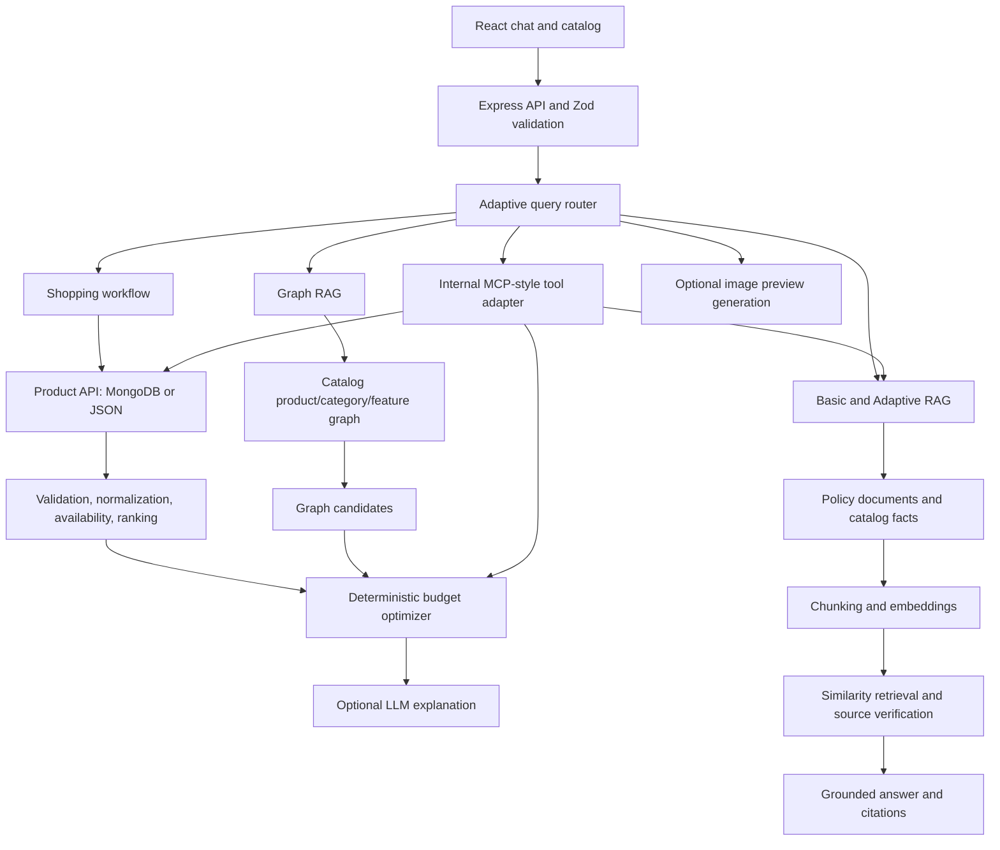

# AI Budget Shopping Assistant

A React + Vite shopping assistant backed by Express. Catalog facts and shopping arithmetic stay in deterministic backend services; optional language and image models explain verified results or create illustrative previews.

## Architecture



The tool adapter is an internal validated JSON adapter, not an MCP-protocol server. It reuses the existing services and is exposed to the app through HTTP.

## Responsibility Boundaries

| Component | Responsibility |
| --- | --- |
| Product API | Load the verified catalog from MongoDB or bundled JSON. |
| Data pipeline | Validate, clean, normalize, deduplicate, filter, and rank products. |
| Budget optimizer | Select combinations and calculate verified totals and remaining budget. |
| Basic RAG | Retrieve policy and product-fact chunks and cite their sources. |
| Adaptive RAG | Route requests, verify retrieval strength, and allow at most one rewrite. |
| Graph RAG | Find catalog relationships and candidate products; it does not calculate totals. |
| Tool adapter | Run validated structured catalog, budget, and policy operations. |
| Image generation | Optionally create a conceptual visual preview from verified categories and known colors. |
| LLM | Explain verified results; it does not own product IDs, features, availability, policies, or arithmetic. |

## API

All paths below are relative to `/api`. The API key column describes whether the endpoint needs an external provider; the server itself runs without one.

| Method and path | Purpose and request example | Response summary | API key |
| --- | --- | --- | --- |
| `GET /api/health` | Liveness check; no body. | `{ "ok": true, "service": "ai-budget-shopping-assistant" }` | No |
| `GET /api/products` | Read cleaned in-stock catalog; optional `?category=headphones`. | Count, pipeline stats, and product objects. | No |
| `POST /api/chat` | `{"sessionId":"session-1234","message":"I have ₹5000 and need a backpack and headphones"}` | Routed shopping, knowledge, graph, tool, preview, or clarification response. | No; optional for model explanations |
| `POST /api/recommend` | `{"budget":5000,"items":["backpack","headphones"],"preferences":["college use"]}` | Verified products, optimizer combinations, totals, explanation. | No; optional for explanation |
| `POST /api/optimize-budget` | `{"budget":5000,"items":["backpack","headphones"]}` | Optimizer combinations and pipeline stats; no LLM. | No |
| `POST /api/analyze-image` | Multipart form with `image` file and optional `sessionId`. | Visible product description and conservative image analysis. | Optional; no-key fallback is available |
| `POST /api/knowledge/query` | `{"query":"Can opened headphones be returned?"}` | Grounded answer, source names/scores, retrieved chunk count, or insufficient context. | No; optional for generated answer wording |
| `POST /api/graph/query` | `{"query":"Which in-stock backpacks are water resistant?"}` | Related products, seed nodes, graph context, and source product IDs. | No |
| `POST /api/tools/:toolName` | Example: `/api/tools/search_products` with `{"input":{"query":"wireless headphones","category":"headphones","maxPrice":2000,"inStockOnly":true}}` | Structured tool result or safe structured error. | No; `get_policy` may use an optional LLM |
| `POST /api/generate-shopping-preview` | `{"productIds":["P105","P201"],"style":"minimal college desk setup"}` | Generated URL and the preview disclaimer, or safe unavailable response. | Optional; generation requires configured image access |

Other tool names are `get_product_details`, `check_budget_bundle`, and `get_policy`. Inputs are validated by Zod. For example:

```json
{"input":{"productId":"P201"}}
```

```json
{"input":{"budget":5000,"items":["backpack","headphones"],"preferences":["college use"]}}
```

### Chat Routing Examples

- `I have ₹5000 and need a backpack and headphones` follows the existing extraction, catalog, optimizer, and explanation flow.
- `Can opened headphones be returned?` uses Adaptive RAG and cites the return source.
- `Which wireless headphones with long battery life fit with a college backpack under ₹5000?` uses graph candidates, then the deterministic optimizer verifies the requested combination.
- `Search in-stock wireless headphones under ₹2000` invokes the catalog search tool.
- `Create a visual preview of my backpack and headphones` uses the optional image preview service.
- Unclear requests receive a clarification rather than an invented answer.

## Environment

Create `backend/.env` as needed. Never commit provider credentials.

| Variable | Default | Purpose |
| --- | --- | --- |
| `PORT` | `3000` | Express listen port. |
| `FRONTEND_ORIGIN` | `http://localhost:5173` | CORS origin. |
| `MONGODB_URI` | empty | Optional MongoDB connection. |
| `OPENAI_API_KEY` | empty | Optional OpenAI-compatible chat, embedding, vision, and image-generation access. |
| `OPENAI_BASE_URL` | `https://api.openai.com/v1` | Compatible provider base URL. |
| `OPENAI_MODEL` | `gpt-4o-mini` | Chat model. |
| `EMBEDDING_MODEL` | `text-embedding-3-small` | Embeddings model. |
| `VISION_MODEL` | `OPENAI_MODEL` or `gpt-4o-mini` | Vision model. |
| `OPENAI_IMAGE_MODEL` | `gpt-image-1` | Image-generation model. |

### Fallbacks and Knowledge Sources

- Without MongoDB, the bundled `backend/src/data/products.json` catalog and in-memory sessions are used.
- Without an LLM key, shopping explanations and image analysis use safe deterministic fallbacks.
- Without remote embeddings, RAG uses deterministic local sparse vectors and cosine similarity. If the provider fails, local embeddings are used for the request/index.
- Without image-generation access, preview requests return: `Image generation is not configured. Real product images are still available.`
- The repository does not include actual retailer terms. Missing return, refund, warranty, or delivery conditions are explicitly reported as unavailable; they are not inferred.
- RAG source documents live in `backend/src/services/rag/documents/`. Add approved material there. The in-memory index is rebuilt when the backend process starts; restart the backend after changing a source document.
- Catalog product-fact documents are generated from the backend catalog during index construction.

## Run and Test

Requirements: Node.js 18 or newer. Install and run the services separately:

```powershell
npm install --prefix backend
npm install --prefix frontend
npm run dev --prefix backend
npm run dev --prefix frontend
```

The backend defaults to `http://localhost:3000`; Vite serves the frontend at `http://localhost:5173` and proxies API requests.

Run checks:

```powershell
npm test --prefix backend
npm run build --prefix frontend
```

## Security and Guarantees

- Browser-supplied prices, availability, product facts, and totals are not trusted.
- Recommendation and graph-candidate combinations are loaded from the backend catalog and checked by `budgetOptimizer.js`.
- The LLM does not select authoritative IDs or compute budget totals.
- Image uploads are size-limited. Preview product IDs must resolve in the verified catalog.
- Generated images are separate from real product images and are labeled `AI-generated visual preview — not the actual product.`
- The internal tool adapter returns structured data and safe errors; it does not expose provider credentials.

See [docs/edvergencex-topic-mapping.md](docs/edvergencex-topic-mapping.md), [docs/architecture-decisions.md](docs/architecture-decisions.md), and [docs/sample-conversations.md](docs/sample-conversations.md).
